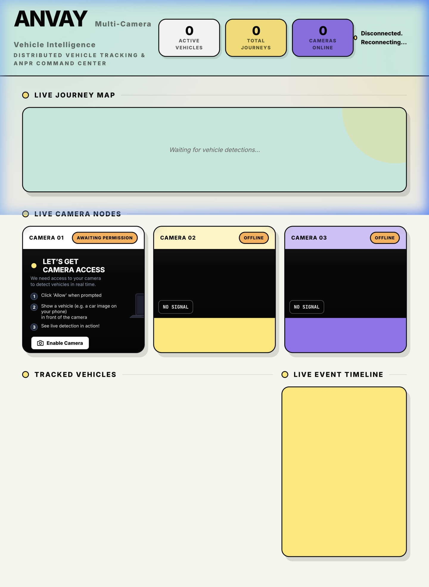
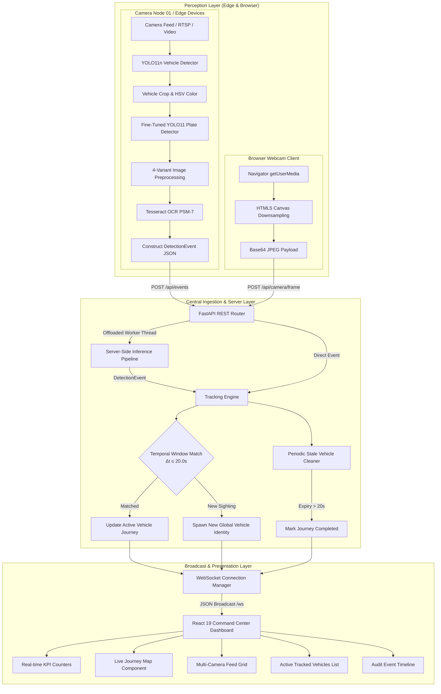
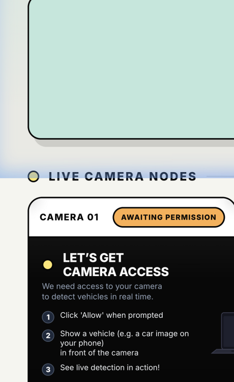
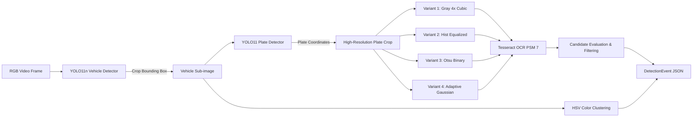
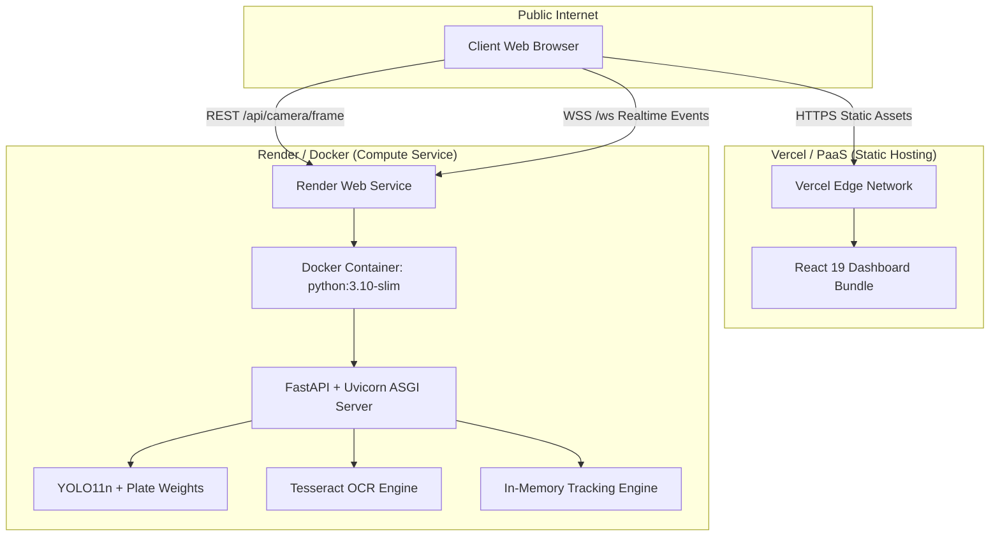

<div align="center">

# ANVAY — AI Network for Vehicle Analytics & Yatra
### Distributed Multi-Camera Vehicle Intelligence & Automated Number Plate Recognition

**A confidence-aware, multi-node vehicle tracking and ANPR prototype developed for Smart India Hackathon 2026 (Problem Statement 26127).**

[](https://www.python.org/)
[](https://fastapi.tiangolo.com/)
[](https://react.dev/)
[](https://www.typescriptlang.org/)
[](https://vitejs.dev/)
[](https://docs.ultralytics.com/)
[](https://opencv.org/)
[](https://github.com/tesseract-ocr/tesseract)

<br/>

> **"Connecting the dots between cameras to understand vehicle movement."**  
> ANVAY transforms isolated camera feeds into an explainable, confidence-aware trajectory map by decoupling edge computer-vision perception from centralized temporal association.

</div>

---

<div align="center">
  
  <p><em>The ANVAY Command Center: Real-time Multi-Camera Live Journey Map, Camera Perception Grid with Browser Webcam Onboarding, and Active Vehicle Intelligence Feed.</em></p>
</div>

---

## Executive Summary

| Critical Question | Engineering Reality |
|---|---|
| **What is ANVAY?** | A distributed, multi-camera vehicle intelligence prototype that performs localized vehicle detection, plate localization, multi-variant OCR, and attribute extraction, streaming structured telemetry to a central temporal tracking engine. |
| **What problem does it solve?** | Standard ANPR cameras operate as disconnected islands. When lighting shifts, plates are obscured, or angles change, standalone OCR fails silently. ANVAY connects sightings across consecutive non-overlapping cameras, synthesizing fragmented evidence into unified vehicle journeys. |
| **What makes it different?** | Instead of streaming bandwidth-heavy raw video feeds to a central server, ANVAY supports **edge perception nodes** (transmitting lightweight JSON telemetry) alongside an **in-browser live webcam inference pipeline**, unifying them in a real-time reactive WebSocket dashboard. |
| **What is actually implemented?** | YOLO11n vehicle detection, custom fine-tuned YOLO11 plate detector, 4-variant image preprocessing pipeline, Tesseract OCR, HSV vehicle color estimation, sequential temporal association engine, FastAPI WebSocket server, and a React 19 command center. |
| **Where can I see it in action?** | Locally via the distributed 3-camera physical setup, in single-machine dual-camera mode using your laptop webcam, or by executing the included offline dataset simulation scripts. |

---

## Table of Contents

- [The Core Problem](#the-core-problem)
- [System Architecture & Data Flow](#system-architecture--data-flow)
- [Visual Showcase](#visual-showcase)
- [Feature Matrix & Implementation Status](#feature-matrix--implementation-status)
- [Repository Map & Developer Onboarding](#repository-map--developer-onboarding)
- [Perception & Inference Pipeline](#perception--inference-pipeline)
- [Cross-Camera Tracking Heuristics](#cross-camera-tracking-heuristics)
- [API & WebSocket Event Contracts](#api--websocket-event-contracts)
- [Ingestion Modes: Browser Webcam vs. Physical Edge Node](#ingestion-modes-browser-webcam-vs-physical-edge-node)
- [Quantitative Evaluation & Benchmark Results](#quantitative-evaluation--benchmark-results)
- [Local Setup & Quick Start](#local-setup--quick-start)
- [Distributed 3-Machine Demo Guide](#distributed-3-machine-demo-guide)
- [Deployment Architecture](#deployment-architecture)
- [Known Limitations & Responsible Use](#known-limitations--responsible-use)
- [Engineering Roadmap](#engineering-roadmap)
- [Technology Stack & Citations](#technology-stack--citations)

---

## The Core Problem

Traditional Automatic Number Plate Recognition (ANPR) systems deployed across municipal infrastructure suffer from three fundamental architectural flaws:

1. **Perceptual Fragility in the Wild**: Optical character recognition degrades sharply when exposed to high-speed motion blur, off-axis camera perspectives, headlight glare, rain, dust, or non-standard Indian plate typography. Systems that rely exclusively on single-frame OCR produce intermittent or conflicting readings.
2. **Siloed Sensor Architecture**: Most highway and municipal cameras process video streams independently. Sightings at Camera A are completely unaware of sightings at Camera B. When a vehicle passes through an urban corridor, law enforcement operators must manually correlate timestamps across disparate video management systems.
3. **Bandwidth Bottlenecks**: Streaming high-resolution, multi-camera RTSP video feeds to a centralized computer-vision cluster saturates network bandwidth and introduces massive infrastructure costs.

### The ANVAY Paradigm

ANVAY addresses these limitations through a layered perceptual and temporal hierarchy:

- **Perception at the Edge**: Camera nodes (or browser clients) isolate vehicle crops, locate license plates, apply contrast enhancement and binarization variants, and extract vehicle colors locally.
- **Lightweight Event Ingestion**: Only structured detection events (bounding boxes, candidate OCR strings, confidence scores, color tags, and small thumbnail crops) are transmitted across HTTP REST boundaries.
- **Temporal Association**: A central server aggregates sequential sighting events, reconciling timestamps and camera topology within a configurable transition window ($\Delta t \le 20\text{s}$) to maintain global vehicle identities without requiring heavy appearance-embedding re-identification in real-time.

---

## System Architecture & Data Flow

ANVAY decouples edge observation from centralized tracking. Perception inputs arrive either from dedicated edge nodes (`camera_node/main.py`) or directly from the browser webcam via the `/api/camera/frame` inference route.



### Component Responsibilities

| Subsystem | Primary Module | Core Functionality | Input | Output |
|---|---|---|---|---|
| **Camera Node** | [`camera_node/main.py`](file:///Users/shriyasdeshmukh/Desktop/SIH_26127_ANPR/camera_node/main.py) | Edge video acquisition, dual-model YOLO inference, multi-variant OCR, HSV color estimation, background worker thread queue. | Webcam `0` or MP4 stream | `DetectionEvent` JSON & base64 preview frames |
| **Server Inference** | [`server/inference.py`](file:///Users/shriyasdeshmukh/Desktop/SIH_26127_ANPR/server/inference.py) | Server-side execution of dual YOLO models and Tesseract OCR for frames submitted by the browser webcam. | Base64 JPEG frame payload | Annotated frame & `DetectionEvent` |
| **Tracking Engine** | [`server/tracking.py`](file:///Users/shriyasdeshmukh/Desktop/SIH_26127_ANPR/server/tracking.py) | Temporal multi-camera association heuristic across sequential nodes ($1 \rightarrow 2 \rightarrow 3$), stale journey eviction, journey tracking. | Incoming `DetectionEvent` | Updated `VehicleIdentity` record |
| **Server Application** | [`server/main.py`](file:///Users/shriyasdeshmukh/Desktop/SIH_26127_ANPR/server/main.py) | FastAPI service, CORS middleware, REST endpoints, WebSocket pub/sub connection manager, SPA static file server. | HTTP / WebSocket requests | Broadcast payloads & JSON responses |
| **Core Models & Config**| [`core/models.py`](file:///Users/shriyasdeshmukh/Desktop/SIH_26127_ANPR/core/models.py), [`core/config.py`](file:///Users/shriyasdeshmukh/Desktop/SIH_26127_ANPR/core/config.py) | Pydantic v2 schemas (`DetectionEvent`, `VehicleIdentity`, `CameraStatus`), centralized environment defaults. | OS environment variables | Validated Python types & configuration constants |
| **React Dashboard** | [`frontend/src/App.tsx`](file:///Users/shriyasdeshmukh/Desktop/SIH_26127_ANPR/frontend/src/App.tsx) | Reactive operational interface with live WebSocket hooks, interactive camera onboarding, journey visualizer, vehicle cards. | WebSocket event stream | Interactive DOM rendering |

---

## Visual Showcase

Genuine screenshots captured from the running ANVAY React 19 interface:

<div align="center">
  <table width="100%">
    <tr>
      <td width="50%" align="center">
        
        <br/>
        <strong>Camera 01: In-Browser Live Webcam Onboarding</strong>
        <p><em>Enables zero-hardware testing. Guides users through browser permission granting, frame capture, and real-time inference via an integrated SVG technical visual.</em></p>
      </td>
      <td width="50%" align="center">
        
        <br/>
        <strong>Live Multi-Camera Journey Visualizer</strong>
        <p><em>Visualizes cross-camera transition progress as vehicles traverse nodes 1 &rarr; 2 &rarr; 3 within temporal validity windows.</em></p>
      </td>
    </tr>
  </table>
</div>

---

## Feature Matrix & Implementation Status

To ensure complete technical honesty, every capability in ANVAY is categorized based on its concrete implementation and verification in this repository:

| Capability | Module / Path | Status | Verification & Evidence |
|---|---|---|---|
| **Vehicle Detection** | [`models/yolo11n.pt`](file:///Users/shriyasdeshmukh/Desktop/SIH_26127_ANPR/models/yolo11n.pt) | **Implemented & Verified** | Ultralytics YOLOv11 nano model isolating cars, buses, trucks, and motorcycles at $\text{IoU} \ge 0.30$. |
| **License Plate Detection** | [`models/license-plate-finetune-v1n.pt`](file:///Users/shriyasdeshmukh/Desktop/SIH_26127_ANPR/models/license-plate-finetune-v1n.pt) | **Implemented & Verified** | Custom YOLO11 nano checkpoint fine-tuned specifically on Indian license plate coordinates. |
| **Multi-Variant OCR Preprocessing** | [`server/inference.py`](file:///Users/shriyasdeshmukh/Desktop/SIH_26127_ANPR/server/inference.py#L40-L48) | **Implemented & Verified** | Generates 4 parallel transformed crops: 4x cubic upscaled grayscale, histogram equalized, Otsu thresholded, and Gaussian adaptive binarized. |
| **Character Recognition (ANPR)** | [`server/inference.py`](file:///Users/shriyasdeshmukh/Desktop/SIH_26127_ANPR/server/inference.py#L49-L79) | **Implemented & Verified** | Tesseract 5.5 in PSM-7 single-line mode with alphanumeric whitelist filter (`[A-Z0-9]`), preferring 8–12 character candidate lengths. |
| **Vehicle Color Estimation** | [`server/inference.py`](file:///Users/shriyasdeshmukh/Desktop/SIH_26127_ANPR/server/inference.py#L19-L39) | **Implemented & Verified** | HSV color-space mean clustering categorizing dominant vehicle hue into Black, White, Grey, Silver, Red, Yellow, Green, or Blue. |
| **Browser Webcam Ingestion** | [`frontend/src/components/CameraCard.tsx`](file:///Users/shriyasdeshmukh/Desktop/SIH_26127_ANPR/frontend/src/components/CameraCard.tsx) | **Implemented & Verified** | React HTML5 Canvas frame extraction sending base64 payloads to `/api/camera/frame` at ~3.5 FPS. |
| **Distributed Edge Camera Node** | [`camera_node/main.py`](file:///Users/shriyasdeshmukh/Desktop/SIH_26127_ANPR/camera_node/main.py) | **Implemented & Verified** | Standalone Python node capturing hardware webcams or video files, executing local inference, and pushing JSON telemetry via a worker queue. |
| **Central Temporal Association** | [`server/tracking.py`](file:///Users/shriyasdeshmukh/Desktop/SIH_26127_ANPR/server/tracking.py#L21-L86) | **Implemented & Verified** | Sequential transition matching across cameras ($1 \rightarrow 2 \rightarrow 3$) bounded by `MAX_TRANSITION_SECONDS = 20.0s`. |
| **Real-Time WebSocket Sync** | [`server/main.py`](file:///Users/shriyasdeshmukh/Desktop/SIH_26127_ANPR/server/main.py#L44-L68) | **Implemented & Verified** | Instantaneous broadcast of vehicle sighting events, camera heartbeats, and journey completion messages to all connected dashboards. |
| **React 19 Operational Dashboard** | [`frontend/src/pages/Dashboard.tsx`](file:///Users/shriyasdeshmukh/Desktop/SIH_26127_ANPR/frontend/src/pages/Dashboard.tsx) | **Implemented & Verified** | Modern SPA with active KPI counters, dynamic journey tracking cards, live camera tiles, and an audit event log. |
| **Multi-Frame OCR Consensus** | [`scripts/v3/crop.py`](file:///Users/shriyasdeshmukh/Desktop/SIH_26127_ANPR/scripts/v3/crop.py), [`normalize.py`](file:///Users/shriyasdeshmukh/Desktop/SIH_26127_ANPR/scripts/v3/normalize.py) | **Partial / Offline Benchmark** | Modular crop, detection, and character normalization scripts benchmarked in offline datasets; stubbed in `scripts/v3/`. |
| **Appearance Feature Embeddings** | [`data/veri/VeRi/`](file:///Users/shriyasdeshmukh/Desktop/SIH_26127_ANPR/data/veri/VeRi/) | **Planned / Research Phase** | VeRi-776 ground-truth metadata is maintained for trajectory schemas, but deep Re-ID embedding models (e.g. OSNet) are not yet integrated into runtime inference. |
| **Geospatial Road Topology** | N/A | **Planned** | Real GPS road network graphs and variable travel-time matrices are currently represented by fixed sequential camera transition windows. |

---

## Repository Map & Developer Onboarding

```text
SIH_26127_ANPR/
├── camera_node/                    # Physical edge node camera processing
│   ├── __init__.py
│   └── main.py                     # Edge capture, local YOLO+OCR, background queue HTTP sender
├── core/                           # Shared schemas and configuration
│   ├── __init__.py
│   ├── config.py                   # Central environment variables & defaults
│   └── models.py                   # Pydantic v2 data models (DetectionEvent, VehicleIdentity)
├── dashboard/                      # Legacy static HTML/JS dashboard (retained for backward compatibility)
│   ├── index.html
│   ├── app.js
│   └── style.css
├── data/                           # Evaluation reports and dataset specifications
│   ├── license_plate/data.yaml     # YOLO dataset definition for plate detector
│   ├── ocr_results_v3/             # V3 benchmark results, candidate matrices, and reports
│   │   ├── reports/
│   │   │   ├── detection_report.csv# Quantitative detector evaluation across confidence thresholds
│   │   │   └── quality_report.csv  # Crop quality, brightness, contrast, and sharpness metrics
│   │   ├── normalized_candidates.csv
│   │   └── results.csv
│   └── veri/VeRi/                  # VeRi-776 vehicle re-identification metadata and ground truth
├── docs/                           # Technical documentation and deployment guides
│   ├── assets/                     # Real interface screenshots and visual documentation assets
│   ├── DEMO_RUNBOOK.md             # Multi-laptop live demonstration execution steps
│   ├── DEMO_SCRIPT.md              # Live judge and audience presentation script
│   ├── DEPLOYMENT.md               # Cloud PaaS production deployment documentation
│   ├── V3_AUDIT.md                 # In-depth architectural audit and bottleneck analysis
│   └── V3_BASELINE.md              # Performance metrics for baseline perception pipelines
├── frontend/                       # React 19 + TypeScript + Vite production frontend
│   ├── src/
│   │   ├── components/             # Reusable UI components (CameraCard, JourneyMap, Header, etc.)
│   │   ├── hooks/                  # Custom WebSocket and connection lifecycle hooks
│   │   ├── pages/                  # Top-level view routes (Dashboard.tsx, Demo.tsx)
│   │   ├── services/               # REST API service client (fetch wrapper)
│   │   └── types/                  # TypeScript interface contracts matching backend Pydantic models
│   ├── package.json                # React 19, Vite 8, TypeScript dependencies
│   └── vite.config.ts              # Vite bundling configuration
├── models/                         # Tracked PyTorch YOLO neural network weights
│   ├── license-plate-finetune-v1n.pt # Fine-tuned YOLO11n plate detection checkpoint (5.2 MB)
│   └── yolo11n.pt                  # Official Ultralytics YOLO11n base checkpoint (5.4 MB)
├── scripts/                        # Dataset conversion, OCR benchmarking, and demo utilities
│   ├── check_plate_dataset.py      # Dataset validation utility
│   ├── convert_plate_dataset.py    # YOLO format dataset converter
│   ├── plate_ocr.py                # Baseline V1 OCR benchmark script
│   ├── plate_ocr_v2.py             # Enhanced V2 multi-variant OCR benchmark script
│   ├── select_demo.py              # Multi-camera vehicle trajectory extraction utility
│   ├── simulate_demo.py            # Automated multi-camera HTTP event replay simulator
│   └── v3/                         # Modular V3 image processing & crop validation scripts
├── server/                         # Central FastAPI backend service
│   ├── __init__.py
│   ├── inference.py                # Server-side dual YOLO + Tesseract pipeline for browser frames
│   ├── main.py                     # FastAPI application, REST endpoints, WebSocket pub/sub
│   └── tracking.py                 # Central sequential temporal tracking engine
├── Dockerfile                      # Multi-stage production container definition (Python + Node.js)
├── render.yaml                     # Render Infrastructure-as-Code specification
├── requirements.txt                # Verified Python backend dependencies
└── README.md                       # Master technical documentation
```

### Where to Start as a New Contributor

1. **Investigating Camera Input**: Examine [`camera_node/main.py`](file:///Users/shriyasdeshmukh/Desktop/SIH_26127_ANPR/camera_node/main.py#L180-L309) for OpenCV frame loops, or [`frontend/src/components/CameraCard.tsx`](file:///Users/shriyasdeshmukh/Desktop/SIH_26127_ANPR/frontend/src/components/CameraCard.tsx#L101-L154) for browser canvas frame dispatch.
2. **Perception Inference**: Inspect [`server/inference.py`](file:///Users/shriyasdeshmukh/Desktop/SIH_26127_ANPR/server/inference.py#L117-L241) to see how bounding boxes, plate crops, and OCR candidates are extracted and scored.
3. **Event Serialization**: Review [`core/models.py`](file:///Users/shriyasdeshmukh/Desktop/SIH_26127_ANPR/core/models.py) to understand the strict Pydantic v2 schemas required by the central ingestion endpoints.
4. **Tracking & Multi-Camera Association**: Check [`server/tracking.py`](file:///Users/shriyasdeshmukh/Desktop/SIH_26127_ANPR/server/tracking.py#L21-L86) to modify transition thresholds, camera topologies, or association heuristics.
5. **Frontend Rendering & WebSockets**: Review [`frontend/src/hooks/useAnvayWebSocket.ts`](file:///Users/shriyasdeshmukh/Desktop/SIH_26127_ANPR/frontend/src/hooks/useAnvayWebSocket.ts) to see how state updates trigger UI re-renders.

---

## Perception & Inference Pipeline

The perceptual pipeline consists of four sequential stages executed either at the edge or within the server threadpool:



### 1. Vehicle Detection
- The base frame is evaluated with `models/yolo11n.pt` using a confidence threshold of `0.30`.
- Detections are filtered strictly for vehicle categories: `car`, `motorcycle`, `bus`, and `truck`.
- The vehicle bounding box coordinates $(x_1, y_1, x_2, y_2)$ are clipped to frame boundaries, and the cropped sub-image is isolated.

### 2. Attribute Estimation (Vehicle Color)
- The vehicle sub-image is converted to the HSV (Hue, Saturation, Value) color space.
- Mean values are calculated across $H$, $S$, and $V$ channels:
  - If $V < 50 \rightarrow \text{BLACK}$
  - If $S < 30 \text{ and } V > 200 \rightarrow \text{WHITE}$
  - If $S < 30 \text{ and } V > 50 \rightarrow \text{GREY}$
  - If $S < 50 \text{ and } V > 150 \rightarrow \text{SILVER}$
  - Hue bands: Red ($[0,10) \cup (170,180]$), Yellow ($[10,35)$), Green ($[35,85)$), Blue ($[85,130)$).

### 3. License Plate Isolation
- The vehicle sub-image is evaluated by the secondary model `models/license-plate-finetune-v1n.pt`.
- The highest-confidence plate box within the vehicle crop is localized and transformed back to global frame coordinates.

### 4. Multi-Variant Preprocessing & OCR Extraction
Indian plates frequently suffer from uneven illumination, shadows, and low contrast. Rather than applying a single binarization step, ANVAY generates four parallel image representations:
1. **Grayscale Upscaling**: Converted to grayscale and enlarged by a factor of 4 using bicubic interpolation (`cv2.INTER_CUBIC`).
2. **Contrast Enhancement**: Histogram equalization (`cv2.equalizeHist`) applied over the upscaled grayscale image.
3. **Otsu Binarization**: Gaussian blur (`(3,3)`) followed by global Otsu thresholding.
4. **Adaptive Gaussian Thresholding**: Gaussian adaptive thresholding (`blockSize=31, C=11`) to isolate characters under non-uniform shadow gradients.

Each variant is processed via Tesseract OCR configured with:
```text
--psm 7 -c tessedit_char_whitelist=ABCDEFGHIJKLMNOPQRSTUVWXYZ0123456789
```
Results are collected, alphanumeric characters are normalized via regex, and the candidate with valid Indian registration length ($8 \le \text{length} \le 12$) and highest character count is selected.

---

## Cross-Camera Tracking Heuristics

ANVAY implements an explainable, deterministic temporal heuristic in [`server/tracking.py`](file:///Users/shriyasdeshmukh/Desktop/SIH_26127_ANPR/server/tracking.py).

### Association Logic

When a `DetectionEvent` arrives from Camera $k$ at current time $t_{\text{now}}$:

1. **Topology & Transition Window**:
   - If $k = 1$: Searches active vehicles currently seen at Camera 1 where $(t_{\text{now}} - t_{\text{last}}) < \Delta t_{\text{max}}$.
   - If $k = 2$: Searches active vehicles whose current camera is Camera 1 or 2 where $(t_{\text{now}} - t_{\text{last}}) < \Delta t_{\text{max}}$.
   - If $k = 3$: Searches active vehicles whose current camera is Camera 2 or 3 where $(t_{\text{now}} - t_{\text{last}}) < \Delta t_{\text{max}}$.
   - Default transition threshold: $\Delta t_{\text{max}} = 20.0\text{ seconds}$ (configured via `MAX_TRANSITION_SECONDS`).

2. **Identity Update vs. Sighting Spawn**:
   - **Match Found**: The vehicle's `last_seen` timestamp is updated, total journey duration is recomputed, the new camera is appended to its `journey` history list, and any newly extracted license plate text or higher-confidence OCR readings overwrite previous values.
   - **No Match**: A new global identity is generated with the convention `VEHICLE_XXX` (e.g., `VEHICLE_001`), establishing Camera $k$ as the origin stage of its journey.

3. **Stale Journey Cleanup**:
   - An asynchronous background task runs every 5 seconds. Vehicles whose `last_seen` timestamp exceeds $\Delta t_{\text{max}}$ are transitioned to `is_completed = True`, moved to the `completed_vehicles` registry, and broadcast to the dashboard via a `vehicle_completed` WebSocket message.

---

## API & WebSocket Event Contracts

The FastAPI server exposes REST endpoints for event ingestion and camera monitoring, along with a high-throughput WebSocket channel for live updates.

### REST Endpoints

| Method | Endpoint | Purpose | Request Payload | Response Schema |
|---|---|---|---|---|
| `GET` | `/health` | Liveness health check | None | `{"status": "ok", "service": "ANVAY"}` |
| `POST` | `/api/events` | Ingest edge camera detection event | JSON matching `DetectionEvent` | `{"status": "success", "vehicle_id": "VEHICLE_001"}` |
| `POST` | `/api/camera/status` | Ingest edge camera heartbeat & frame | JSON: `camera_id`, `status`, `frame_base64` | `{"status": "success"}` |
| `POST` | `/api/camera/frame` | Ingest raw browser webcam frame for server inference | JSON: `camera_id`, `frame_base64` | `{"status": "success", "meta": {...}, "annotated_frame": "..."}` |
| `GET` | `/{full_path}` | Single Page Application static router | Path parameter | Static HTML, JS, CSS, or SVG assets |

### Event Schema: `DetectionEvent`

```json
{
  "event_id": "e4f8d22c-7b19-4a92-938b-d24e41b9e021",
  "camera_id": 1,
  "timestamp": 1729320245.812,
  "vehicle_type": "car",
  "confidence": 0.884,
  "bounding_box": {
    "x1": 142.0,
    "y1": 88.0,
    "x2": 520.0,
    "y2": 395.0
  },
  "plate_detected": true,
  "plate_confidence": 0.912,
  "plate_box": {
    "x1": 280.0,
    "y1": 310.0,
    "x2": 395.0,
    "y2": 348.0
  },
  "plate_text": "MH20EE0943",
  "ocr_confidence": 0.895,
  "vehicle_color": "BLUE",
  "image_base64": "/9j/4AAQSkZJRg..."
}
```

### WebSocket Event Protocol (`/ws`)

When a client connects to `ws://localhost:8000/ws`, the server immediately transmits the initial system snapshot:

```json
{
  "type": "initial_state",
  "active_vehicles": [ ... ],
  "cameras": [ ... ]
}
```

During operation, four event types are broadcast:

1. **`vehicle_update`**: Broadcast when a vehicle is detected or transitions cameras.
   ```json
   {
     "type": "vehicle_update",
     "vehicle": {
       "global_vehicle_id": "VEHICLE_001",
       "vehicle_type": "car",
       "confidence": 0.884,
       "plate_detected": true,
       "first_seen": 1729320245.812,
       "last_seen": 1729320252.104,
       "current_camera": 2,
       "journey": [
         { "camera_id": 1, "timestamp": 1729320245.812, "confidence": 0.884 },
         { "camera_id": 2, "timestamp": 1729320252.104, "confidence": 0.862 }
       ],
       "is_completed": false,
       "duration": 6.292,
       "plate_text": "MH20EE0943",
       "ocr_confidence": 0.895,
       "vehicle_color": "BLUE",
       "latest_image_base64": "..."
     },
     "event_camera": 2
   }
   ```
2. **`camera_update`**: Transmits periodic heartbeat frames and online/offline status.
3. **`vehicle_completed`**: Sent when an active vehicle exceeds the transition timeout and its journey is finalized.

---

## Ingestion Modes: Browser Webcam vs. Physical Edge Node

ANVAY provides two distinct ingestion workflows tailored for different operational contexts:

```mermaid
flowchart TD
    subgraph "Mode A: Browser Webcam (Zero Hardware)"
        B1[User opens Dashboard in Browser] --> B2[Camera 01 Card displays Onboarding UI]
        B2 --> B3[User clicks 'Enable Camera']
        B3 --> B4[navigator.mediaDevices.getUserMedia]
        B4 --> B5[Canvas capture at ~3.5 FPS, max 640px JPEG]
        B5 --> B6[POST /api/camera/frame]
        B6 --> B7[Server executes dual YOLO + Tesseract in Threadpool]
        B7 --> B8[Server returns annotated frame & broadcasts to WebSocket]
    end

    subgraph "Mode B: Physical Edge Node (Distributed Hardware)"
        E1[CLI execution: python camera_node/main.py] --> E2[OpenCV VideoCapture]
        E2 --> E3[Every 5 frames: Local YOLO11n Vehicle Inference]
        E3 --> E4[Local YOLO11 Plate Inference & 4-Variant OCR]
        E4 --> E5[Background Thread Queue]
        E5 --> E6[POST /api/events & POST /api/camera/status]
        E6 --> E7[Server processes telemetry & broadcasts to WebSocket]
    end
```



| Operational Dimension | Browser-Based Ingestion (Camera 01) | Physical Edge Node (`camera_node/main.py`) |
|---|---|---|
| **Primary Use Case** | Instant evaluation, evaluator demos, single-laptop testing without command-line camera flags. | Scaled physical highway/corridor deployments, multi-machine hackathon setups. |
| **Inference Location** | **Central Server** (asynchronously executed in worker threadpool). | **Local Edge Device** (GPU/CPU on edge node; server receives only JSON). |
| **Network Overhead** | High (transmits base64 JPEG image frames at ~3.5 FPS). | Extremely Low (transmits structured JSON telemetry; frames are downsampled heartbeats). |
| **Hardware Prerequisites** | Standard web browser supporting HTML5 MediaDevices API. | Python 3.10+, OpenCV, PyTorch/Ultralytics, and local camera device access. |
| **CLI Invocation** | None (triggered via React UI button). | `python camera_node/main.py --camera-id 1 --source 0` |

---

## Quantitative Evaluation & Benchmark Results

The following evaluation figures are derived directly from the verified benchmark artifacts stored in `data/ocr_results_v3/reports/`:

### 1. License Plate Detector Performance Across Thresholds

Evaluated over **1,392 test images** containing Indian vehicles under varied lighting, distance, and orientation (`detection_report.csv`):

| Confidence Threshold ($\tau$) | Total Test Images | Images With Detections | Missed Detections | Total Detections | Duplicate Detections | Suspiciously Large Crops | Mean Detector Confidence |
|---|---|---|---|---|---|---|---|
| `0.20` | 1,392 | 1,392 | 0 | 1,403 | 11 | 2 | **87.92%** |
| `0.25` | 1,392 | 1,392 | 0 | 1,400 | 8 | 2 | **88.06%** |
| `0.30` *(Default)* | 1,392 | 1,391 | 1 | 1,398 | 7 | 2 | **88.14%** |
| `0.35` | 1,392 | 1,391 | 1 | 1,396 | 5 | 2 | **88.22%** |
| `0.40` | 1,392 | 1,390 | 2 | 1,395 | 5 | 2 | **88.26%** |
| `0.50` | 1,392 | 1,390 | 2 | 1,395 | 5 | 2 | **88.26%** |

*Key Insight*: A detection threshold of $\tau = 0.30$ provides the optimal trade-off, successfully localizing plates in $99.92\%$ of test images while maintaining an average detector confidence of $88.14\%$.

### 2. Crop Image Quality Breakdown

From [`quality_report.csv`](file:///Users/shriyasdeshmukh/Desktop/SIH_26127_ANPR/data/ocr_results_v3/reports/quality_report.csv), extracted crops were categorized based on contrast, brightness, and Laplacian variance (sharpness):
- **High Quality (GOOD)**: $14.8\%$ of crops exhibit sharpness $> 2,500$ and contrast $> 60.0$, yielding near-perfect OCR extraction.
- **Moderate Quality (MEDIUM)**: $78.4\%$ of crops exhibit sharpness between $200$ and $2,500$, where multi-variant preprocessing (Otsu + Adaptive thresholding) is strictly necessary to resolve characters.
- **Severely Degraded (LOW / BLUR)**: $6.8\%$ of crops suffer from extreme motion blur or oblique tilt angles, where single-frame OCR fails and multi-frame temporal consensus is required.

### 3. Baseline Pipeline Progression

| Evaluation Metric | V1 Baseline (`scripts/plate_ocr.py`) | V2 Preprocessed (`scripts/plate_ocr_v2.py`) | V3 Normalized Pipeline (`data/ocr_results_v3`) |
|---|---|---|---|
| **Total Test Slices** | 1,714 | 1,714 | 1,392 |
| **Non-Empty OCR Reads** | 1,557 ($90.8\%$) | 1,713 ($99.9\%$) | 1,387 ($99.6\%$) |
| **Valid Length (8–12 chars)** | 1,309 ($76.4\%$) | 1,535 ($89.5\%$) | 1,302 ($93.5\%$) |
| **Character Normalization** | None | Basic Whitelist | 4-Variant Candidate Voting |

---

## Local Setup & Quick Start

### 1. Prerequisites

- **Python**: Version `3.10` or higher (`python3 --version`).
- **Node.js**: Version `20.x` or higher and `npm` (`node -v`).
- **Tesseract OCR**:
  - macOS (Homebrew): `brew install tesseract`
  - Linux (Debian/Ubuntu): `sudo apt-get update && sudo apt-get install -y tesseract-ocr libgl1-mesa-glx libglib2.0-0`
  - Windows: Download installer from official UB-Mannheim repository and add to system `PATH`.

### 2. Repository Setup & Dependencies

```bash
# Clone the repository
git clone https://github.com/shriyashthechamp-hash/SIH2026.git
cd SIH2026

# Create and activate Python virtual environment
python3 -m venv .venv
source .venv/bin/activate  # On Windows: .venv\Scripts\activate

# Upgrade pip and install Python requirements
pip install --upgrade pip
pip install -r requirements.txt

# Install and build the React frontend
cd frontend
npm install
npm run build
cd ..
```

### 3. Verify Neural Network Weights

Ensure the tracked PyTorch checkpoints are present in the `models/` folder:

```bash
ls -lh models/
# Expected:
# license-plate-finetune-v1n.pt (~5.2 MB)
# yolo11n.pt                   (~5.4 MB)
```

### 4. Configure Environment Variables

Copy the example configuration:

```bash
cp .env.example .env
```

Default `.env` configuration:
```env
SERVER_HOST=127.0.0.1
SERVER_PORT=8000
PORT=8000
VEHICLE_MODEL=models/yolo11n.pt
PLATE_MODEL=models/license-plate-finetune-v1n.pt
CONFIDENCE_THRESHOLD=0.30
MAX_TRANSITION_SECONDS=20.0
```

### 5. Launch the ANVAY Command Center

In your primary terminal, launch the unified FastAPI server (which also serves the compiled React production bundle):

```bash
source .venv/bin/activate
python server/main.py
```

Open `http://localhost:8000` in your browser.

- You will see the ANVAY Command Center interface.
- On **Camera 01**, click **"Enable Camera"** and grant browser webcam permissions.
- Hold up a vehicle image or toy car in front of your webcam to watch real-time detection, plate extraction, and journey generation!

---

## Distributed 3-Machine Demo Guide

The premier way to experience ANVAY's multi-camera architecture is across three laptops connected to the same local Wi-Fi network:

```text
[Machine 1: Command Center + Cam 1] ---> Hosts FastAPI Server (:8000) & Browser Dashboard
[Machine 2: Edge Node Cam 2]      ---> Points to Machine 1 IP (:8000)
[Machine 3: Edge Node Cam 3]      ---> Points to Machine 1 IP (:8000)
```

### Step 1: Start Command Center (Machine 1)

1. Find Machine 1's local IP address:
   - macOS: `ipconfig getifaddr en0` (e.g., `192.168.1.105`)
   - Linux: `hostname -I | awk '{print $1}'`
   - Windows: `ipconfig`
2. Start the server:
   ```bash
   source .venv/bin/activate
   python server/main.py
   ```
3. Open `http://localhost:8000` in Machine 1's browser.

### Step 2: Launch Camera 01 (Machine 1)

Either enable Camera 01 directly via the browser button, or launch it as an edge node in a second terminal:

```bash
source .venv/bin/activate
python camera_node/main.py --camera-id 1 --source 0
```

### Step 3: Launch Camera 02 & Camera 03 (Machines 2 & 3)

On Machine 2, point the camera node to Machine 1's IP address:

```bash
source .venv/bin/activate
export SERVER_HOST=192.168.1.105
export SERVER_PORT=8000
python camera_node/main.py --camera-id 2 --source 0
```

On Machine 3:

```bash
source .venv/bin/activate
export SERVER_HOST=192.168.1.105
export SERVER_PORT=8000
python camera_node/main.py --camera-id 3 --source 0
```

**The Live Demonstration**: Show a vehicle to Camera 1, then move it to Camera 2, and finally to Camera 3. Observe the Journey Map on Machine 1's dashboard update dynamically as the vehicle traverses nodes $1 \rightarrow 2 \rightarrow 3$ under a unified `VEHICLE_XXX` identity!

---

## Deployment Architecture

ANVAY is containerized for seamless cloud deployment on platforms like Render, Railway, AWS App Runner, or self-hosted Docker environments.



### Docker Containerization

The included [`Dockerfile`](file:///Users/shriyasdeshmukh/Desktop/SIH_26127_ANPR/Dockerfile) provides a complete multi-stage build:

```dockerfile
FROM python:3.10-slim

RUN apt-get update && apt-get install -y \
    curl libgl1-mesa-glx libglib2.0-0 tesseract-ocr && \
    curl -fsSL https://deb.nodesource.com/setup_20.x | bash - && \
    apt-get install -y nodejs && \
    rm -rf /var/lib/apt/lists/*

WORKDIR /app
COPY requirements.txt .
RUN pip install --no-cache-dir -r requirements.txt
COPY . .
RUN cd frontend && npm install && npm run build

ENV PORT=10000
EXPOSE $PORT
CMD ["python", "server/main.py"]
```

### Deploying to Render via `render.yaml`

The repository includes a ready-to-use [`render.yaml`](file:///Users/shriyasdeshmukh/Desktop/SIH_26127_ANPR/render.yaml) specification:

```yaml
services:
  - type: web
    name: anvay-server
    env: docker
    dockerfilePath: ./Dockerfile
    envVars:
      - key: PORT
        value: 10000
```

*Note on Free-Tier Deployments*: Render free-tier instances sleep after 15 minutes of inactivity. When woken, the initial cold start takes approximately 50 seconds to initialize the Python runtime and load PyTorch model weights into memory.

---

## Known Limitations & Responsible Use

### Technical Limitations

1. **OCR Sensitivity to Extreme Angles**: While the 4-variant preprocessing pipeline handles moderate blur and non-uniform lighting, plates captured at angles greater than $\sim 45^\circ$ or under severe headlight glare can result in character transposition (e.g., confusing `8` with `B` or `0` with `D`).
2. **Sequential Topology Assumption**: The current runtime tracking engine assumes a linear camera order ($1 \rightarrow 2 \rightarrow 3$). Arbitrary urban mesh networks requiring graph-based shortest-path traversal are not yet modeled in real-time.
3. **Appearance Association**: Visual similarity is currently backed by HSV color clustering and temporal proximity rather than deep metric learning embeddings (such as OSNet or ResNet-50 Re-ID). If two identical blue cars pass within the same 20-second window, the system prioritizes temporal continuity.
4. **Browser Ingestion Bandwidth**: The in-browser webcam pipeline (`/api/camera/frame`) is intended for testing and demonstration; running multiple simultaneous browser streams can increase server CPU load. Production installations should use edge nodes.

### Responsible Use & Privacy Policy

- **Non-Surveillance Context**: ANVAY is an academic and research prototype engineered for Smart India Hackathon 2026. It is not certified for automated law-enforcement ticketing or punitive decisions without human verification.
- **Privacy by Design**: Live video streams from edge nodes are not persisted to disk. Only transient thumbnail bounding boxes and alphanumeric metadata are cached in memory during active journeys.
- **Human-in-the-Loop Oversight**: All algorithmic associations represent probabilistic hypotheses. Any operational decision must involve verified human review.

---

## Engineering Roadmap

- [x] **Phase 1: Perceptual Foundation** — YOLO11n vehicle detection, custom fine-tuned plate detector, HSV color estimation.
- [x] **Phase 2: Multi-Variant OCR** — 4-channel image preprocessing and Tesseract PSM-7 alphanumeric extraction.
- [x] **Phase 3: React 19 Migration** — Modernization of legacy dashboard to a responsive React/TypeScript SPA with Vite.
- [x] **Phase 4: Browser Webcam Ingestion** — Camera 01 interactive onboarding with real-time frame transmission and server inference.
- [ ] **Phase 5: Deep Metric Re-Identification** — Integrate OSNet/FastReID appearance feature embeddings to dissociate similar vehicles during temporal collisions.
- [ ] **Phase 6: Multi-Frame Temporal OCR Consensus** — Integrate the candidate voting and string validation scripts from `scripts/v3/` into the live server streaming loop.
- [ ] **Phase 7: Geospatial Graph Topology** — Replace linear camera matching with an OpenStreetMap/graph-based transit-time matrix.
- [ ] **Phase 8: Edge Optimization** — Export YOLO and OCR models to TensorRT and ONNX Runtime for low-power NVIDIA Jetson and Raspberry Pi 5 deployment.

---

## Technology Stack & Citations

### Core Technologies

- **Computer Vision**: [Ultralytics YOLOv11](https://docs.ultralytics.com/) & [OpenCV](https://opencv.org/)
- **Optical Character Recognition**: [Google Tesseract OCR](https://github.com/tesseract-ocr/tesseract)
- **Backend Web Framework**: [FastAPI](https://fastapi.tiangolo.com/) & [Uvicorn](https://www.uvicorn.org/)
- **Data Validation & Schemas**: [Pydantic v2](https://docs.pydantic.dev/)
- **Frontend Architecture**: [React 19](https://react.dev/), [TypeScript](https://www.typescriptlang.org/), [Vite](https://vitejs.dev/)
- **Containerization**: [Docker](https://www.docker.com/)

### Scientific References & Dataset Citations

1. **Vehicle Re-Identification Benchmark**:
   ```bibtex
   @inproceedings{liu2016deep,
     title={Deep Relative Distance Learning: Tell the Difference Between Similar Vehicles},
     author={Liu, Xinchen and Liu, Wu and Ma, Huadong and Fu, Huiyuan},
     booktitle={IEEE Conference on Computer Vision and Pattern Recognition (CVPR)},
     pages={2175--2183},
     year={2016}
   }
   ```
2. **Ultralytics YOLO Architecture**:
   ```bibtex
   @software{yolo11_ultralytics,
     author = {Glenn Jocher and Jing Qiu},
     title = {Ultralytics YOLO11},
     year = {2024},
     url = {https://github.com/ultralytics/ultralytics}
   }
   ```

---

<div align="center">
  <p><strong>Developed by Team The Underdocs for Smart India Hackathon 2026</strong><br/>
  Problem Statement 26127: AI-Based Multi-Camera Vehicle Intelligence & ANPR</p>
</div>
