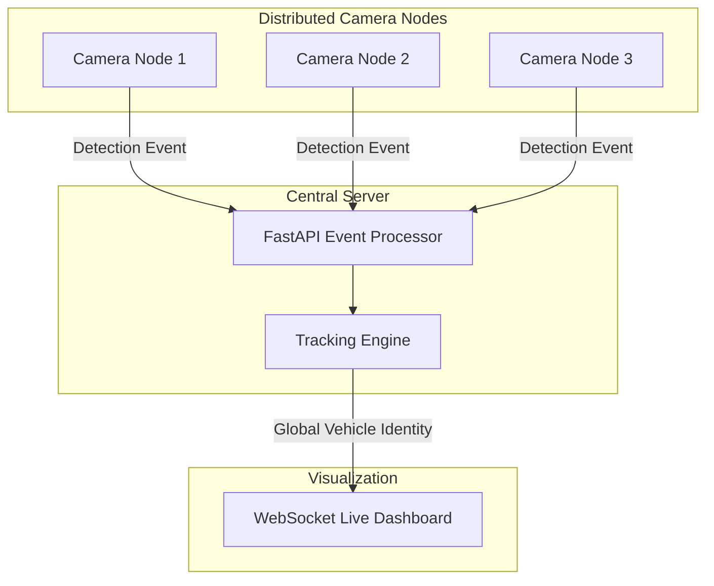
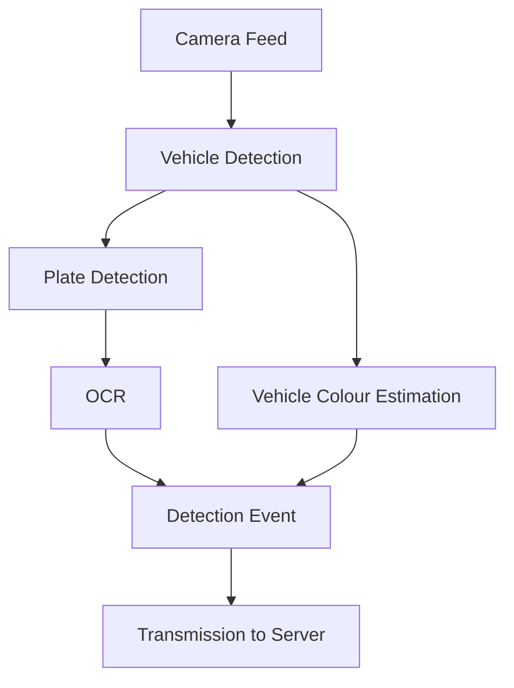

<div align="center">
  <h1>🚗 ANVAY</h1>
  <h3>Distributed Multi-Camera Vehicle Intelligence</h3>
  <p>Real-time vehicle detection, Indian license plate recognition, vehicle attribute extraction and cross-camera tracking.</p>

  <p>
    Vehicle Detection · License Plate Detection · OCR · Vehicle Colour · Cross-Camera Tracking · Live Dashboard
  </p>

  <p>
    <a href="#-anvay-in-action">🎬 WATCH DEMO</a> •
    <a href="#-distributed-3-mac-demo">💻 DISTRIBUTED DEMO</a> •
    <a href="#-quick-start">⚙️ QUICK START</a>
  </p>

  [](https://www.python.org/)
  [](https://fastapi.tiangolo.com/)
  [](https://ultralytics.com/)
  [](https://opencv.org/)
  [](https://developer.mozilla.org/en-US/docs/Web/API/WebSockets_API)
</div>

---

## 🎬 ANVAY IN ACTION

ANVAY processes vehicles at distributed camera nodes, extracts vehicle intelligence locally, and sends structured events to a central server for cross-camera tracking and visualization.

> [!NOTE]
> [ DEMO GIF WILL GO HERE ]

### Full System Demonstration

[Watch the complete ANVAY demo](https://drive.google.com/open?id=demo_placeholder_link)

---

## 🔎 WHAT ANVAY SEES

When a vehicle passes an ANVAY camera node, the pipeline extracts these attributes in real-time before broadcasting the event to the central server:

```text
Vehicle detected
→ CAR
→ 88%

Plate detected
→ YES
→ 74%

OCR
→ MH20EE0943

Vehicle colour
→ BLUE
```

---

## 🏗️ ARCHITECTURE



Each camera node runs an independent edge-processing pipeline:



---

## 🧠 HOW ANVAY WORKS

### 01 — Vehicle Detection
The local camera node captures real-time frames and runs YOLO to detect vehicles and extract tight bounding box crops.

### 02 — License Plate Detection
A specialized secondary YOLO model isolates the license plate from the vehicle crop for high-accuracy extraction.

### 03 — Plate OCR
The extracted license plate is processed using Tesseract OCR to read Indian vehicle registration numbers.

### 04 — Vehicle Attribute Extraction
The node analyzes the main vehicle crop to estimate the primary colour of the vehicle using HSV color space clustering.

### 05 — Event Transmission
The localized intelligence is packaged into a structured `DetectionEvent` and transmitted to the central server via HTTP. Full annotated frames are broadcasted continuously.

### 06 — Cross-Camera Tracking
The central server's tracking engine aggregates local events, performing temporal matching to maintain a global vehicle identity as cars move between distinct physical cameras.

### 07 — Live Visualization
The server broadcasts the aggregated state and live camera feeds via WebSockets to a responsive, cinematic dashboard.

---

## 🚀 CAPABILITIES

| Capability | Description |
|---|---|
| **Vehicle Detection** | Real-time vehicle detection using YOLO |
| **Plate Detection** | Dedicated license plate detector |
| **Indian ANPR** | OCR extraction from detected plates |
| **Vehicle Colour** | Colour estimation from vehicle crops |
| **Cross-Camera Tracking** | Maintains vehicle identity across camera nodes |
| **Live Dashboard** | WebSocket-powered visualization |
| **Distributed Nodes** | Independent camera processing nodes |
| **Simulation** | Local simulation for development/testing |

---

## 💻 DISTRIBUTED 3-MAC DEMO

This is the primary way to experience ANVAY's distributed architecture. 

**Mac 1** → Central server + Camera 1  
**Mac 2** → Camera 2  
**Mac 3** → Camera 3  

All three machines must communicate over the same local network. Start the server on Mac 1, then start the camera nodes on all machines.

### CENTRAL SERVER (Mac 1)
```bash
cd ~/Desktop/SIH_26127_ANPR
source .venv/bin/activate
python server/main.py
```

### CAMERA 1 (Mac 1)
```bash
source .venv/bin/activate
export SERVER_HOST=127.0.0.1
python camera_node/main.py --camera-id 1 --source 0
```

### CAMERA 2 & CAMERA 3 (Mac 2 & Mac 3)
Replace `192.168.X.X` with Mac 1's actual IP address.
```bash
source .venv/bin/activate
export SERVER_HOST=192.168.X.X
python camera_node/main.py --camera-id 2 --source 0
# And similarly for camera 3
```

**The Physical Demonstration:** As a vehicle moves across the physical space from Camera 1 → Camera 2 → Camera 3, ANVAY maintains the vehicle identity on the live dashboard.

---

## ⚙️ QUICK START

To run everything locally on a single machine:

```bash
# 1. Clone the repository
git clone https://github.com/shriyashthechamp-hash/SIH2026.git
cd SIH2026

# 2. Install Dependencies
python -m venv .venv
source .venv/bin/activate
pip install -r requirements.txt

# 3. Setup Environment Variables
cp .env.example .env

# 4. Start the Server
python server/main.py

# 5. Start a Local Camera Node
python camera_node/main.py --camera-id 1 --source 0
```
Open `http://localhost:8000/dashboard` in your browser.

---

## 📁 PROJECT STRUCTURE

```text
ANVAY/
├── camera_node/
│   └── main.py
├── server/
│   ├── main.py
│   └── tracking.py
├── core/
│   ├── config.py
│   └── models.py
├── dashboard/
│   ├── index.html
│   ├── app.js
│   └── style.css
├── models/
├── scripts/
├── requirements.txt
└── README.md
```

---

## 🛠️ TECH STACK

| Layer | Technology |
|---|---|
| **Vision** | YOLO / Ultralytics |
| **Image Processing** | OpenCV |
| **OCR** | Tesseract |
| **Backend** | FastAPI |
| **Communication** | HTTP + WebSocket |
| **Frontend** | HTML / CSS / JavaScript |
| **Runtime** | Python |

---

## ⚙️ ENGINEERING HIGHLIGHTS

- **Edge-side inference:** Vehicle intelligence is computed at the node, massively reducing network bandwidth requirements.
- **Distributed camera nodes:** Allows infinite scalability by adding inexpensive camera nodes without overloading a central inference server.
- **Centralized event processing:** The central server only processes lightweight structured JSON events rather than heavy video streams.
- **Cross-camera tracking engine:** A custom temporal engine maintains unified global vehicle identities without overlapping fields of view.
- **WebSocket dashboard updates:** True real-time visualization of the entire ecosystem with zero polling delay.
- **Modular architecture:** Clean separation between the `camera_node`, `server`, and `dashboard` boundaries.

---

## 🎥 DEMO SCENARIO

1. Vehicle enters Camera 1's field of view.
2. Vehicle detected.
3. Plate detected.
4. OCR extracted.
5. Colour estimated.
6. Central server creates Global Vehicle Identity.
7. Vehicle appears at Camera 2.
8. Central server matches identity based on temporal and visual heuristics.
9. Vehicle appears at Camera 3.
10. Trajectory completed and visualized seamlessly on the dashboard.

---

## 🔮 ROADMAP

- Historical database integration
- Cloud deployment for central server
- Stronger vehicle re-identification features
- Challenging lighting robustness
- Larger-scale deployment

---

## 🏆 Built for Smart India Hackathon
